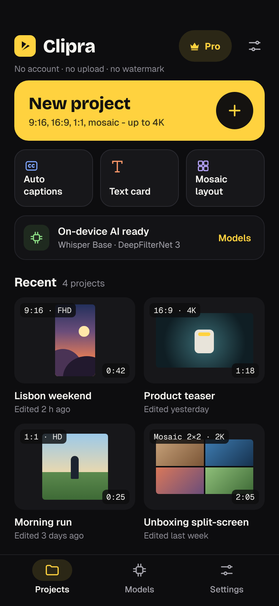
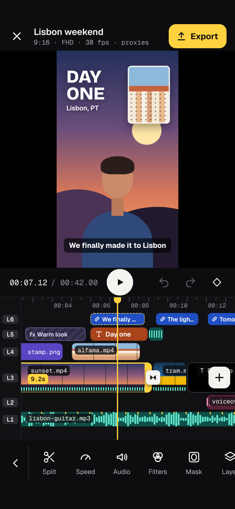
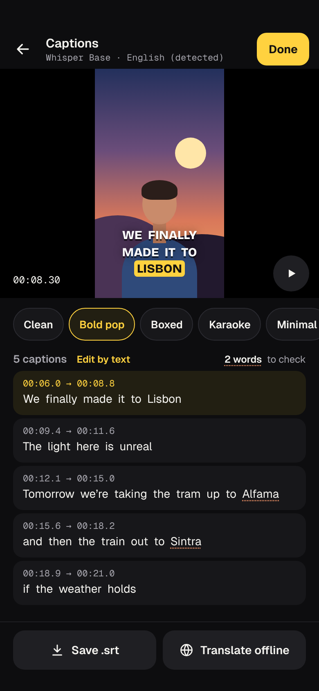
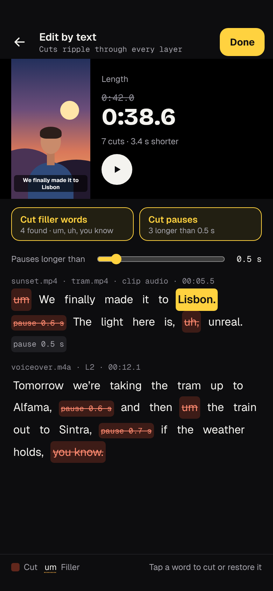
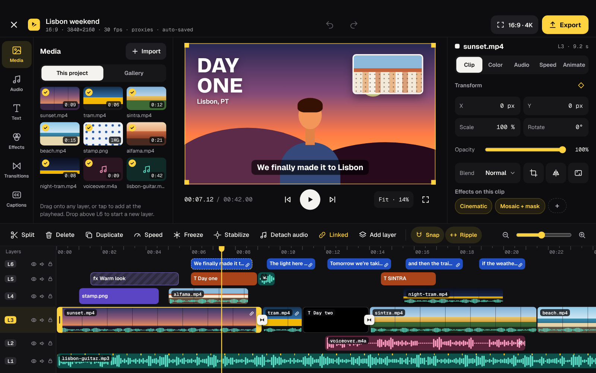

# Clipra

An Android video editor for phones and tablets. No account, no upload, no watermark: every AI feature (Whisper captions, edit by text, voice cleanup, cutout, face tracking, auto-reframe) runs on the device.

## Features (v1)

- Projects in 9:16, 16:9, 1:1, 4:5, 4:3, 21:9 and split-screen layouts, HD to 4K, 24 to 60 fps
- A layered timeline where anything can go on any layer, with 16 blend modes, keyframes and speed ramps
- 24 filters (including Mosaic), 24 transitions, rectangle and oval masks with face following, colour grading with LUTs
- Text cards and titles with 12 effects and animations
- Per-clip loudness normalization, noise reduction, on-device AI voice cleanup, ducking and beat markers
- Offline Whisper captions with styles, `.srt` and offline translation; edit the video by deleting words and pauses
- Person cutout, chroma key and auto-reframe
- Background export from original media with H.264, HEVC or AV1
- Free with two ads per export; Clipra Pro (10 PLN, one time) removes them

## Status

Design complete; implementation is planned in GitHub Project 6 (ClipraPlan). See [docs/plan/ROADMAP.md](docs/plan/ROADMAP.md).

## Documentation

- [Design](design/README.md): every screen, flows, tokens and the design system
- [Product spec](docs/product/spec.md)
- [Monetization](docs/product/monetization.md)
- [Architecture](docs/architecture.md)
- [Roadmap](docs/plan/ROADMAP.md)
- [CLAUDE.md](CLAUDE.md): how to work in this repo

## License

Apache License 2.0. See [LICENSE](LICENSE) and [NOTICE](NOTICE). Third-party components are listed in [docs/third-party.md](docs/third-party.md).
